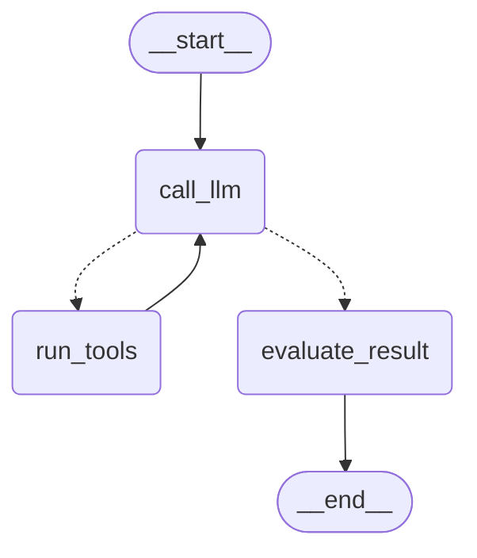

# Evidencia Lab 21 - Agentes con LangGraph

**Fecha:** 2026-08-27  
**Rama:** `Diego-Tique`  
**Objetivo:** Grafo LangGraph con estados explícitos, tools sobre el store FastAPI y endpoint `POST /agent/query`.

---

## 1. Diseño

Nodos: `call_llm` → (si hay `tool_calls`) `run_tools` → `call_llm` → `evaluate_result` → `END`.

Tools de mínimo privilegio:

- `get_active_users` — usuarios con `status=ACTIVE` en `users_db`
- `get_user_count` — conteo total del mismo store

Si Azure OpenAI no está configurado, `ScriptedEnrollmentLlm` emite tool calls reales (no inventa usuarios). El endpoint sanitiza el prompt igual que el lab 20.

También se añadieron `GET /users/count` y `GET /users?active=true` para alinear el contrato HTTP del laboratorio.

---

## 2. Comandos ejecutados

```powershell
python -m pip install -r requirements.txt
python -m pytest tests/ -v
```

```text
17 passed in 0.64s
Python 3.13.3
langgraph 0.6.6 / FastAPI 0.141.1
```

---

## 3. Respuesta HTTP de `POST /agent/query`

```json
{
  "response": "Enrollment report based on system data:\n[{\"id\": 1, \"username\": \"diego_tique\", \"email\": \"diego@globaledb.com\", \"status\": \"ACTIVE\"}]",
  "nodes": ["call_llm", "run_tools", "call_llm", "evaluate_result"]
}
```

HTTP 200. El ciclo recorre LLM → tools → LLM → evaluación.

---

## 4. Diagrama Mermaid del grafo (`GET /agent/graph`)



Texto exportado también en `graph.mmd`.

---

## 5. Seguridad

- Prompt de inyección → HTTP 400 (`Prompt rejected by safety policy`).
- Tools sin parámetros libres; leen solo `users_db`.
- Claves de modelo solo por variables de entorno, no en código.
